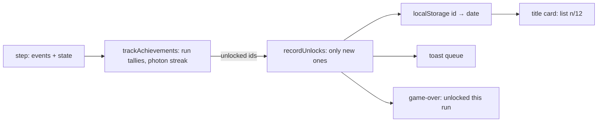

# Achievements (P16)

SPEC.md §13 holds the list. This file adds the structure and the invariants the tests pin.

## Invariants (EARS)

- **INV-1**: Each tick's unlocks shall be known ids, in list order, without repeats.
- **INV-2**: The tracker shall never mutate its input run.
- **INV-3**: The same seed and inputs shall unlock the same achievements on the same ticks.
- **INV-4**: An achievement shall toast and be stored once; its first date is kept.
