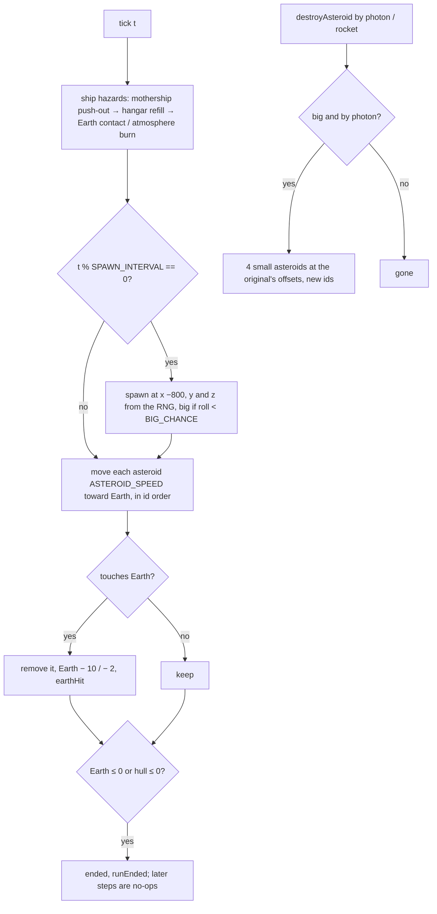

# Asteroids, Earth and ship hazards (P05)

SPEC.md §3 (hazards), §4 and §6 (run end) hold the rules. This file adds the structure and the invariants the tests pin.

## Invariants (EARS)

- **INV-1**: Alive asteroids shall always equal spawned + 4 × photon-split bigs − Earth impacts − kills (split conservation).
- **INV-2**: Asteroid ids shall stay unique, strictly increasing in the list, and below `nextId`.
- **INV-3**: Earth's health shall stay in 0..`EARTH_MAX_HEALTH` and never increase.
- **INV-4**: When the run has ended, `step` shall return the same state object and no events.
- **INV-5**: The same seed and inputs shall give the same asteroids, and different seeds different ones.
- **INV-6**: While the ship is inside the atmosphere (outside Earth's contact radius), its hull shall drop by exactly
  `ATMOSPHERE_BURN` per tick, and the hangar refill shall fire `shipReloaded` only on ticks that refill something.
