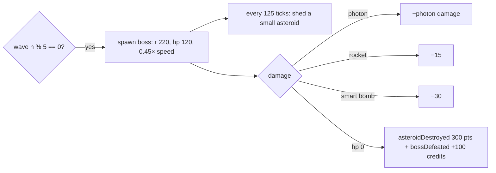
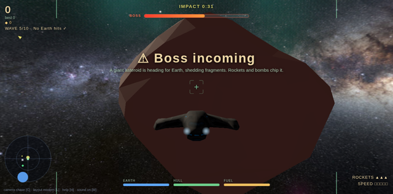

# Boss waves

SPEC.md §10 holds the rules. This file adds the structure and the invariants the tests pin.

## Invariants (EARS)

- **INV-1**: WHEN a wave whose number is a multiple of 5 starts THE sim SHALL spawn a boss asteroid (radius 220, 120 hp, 0.45 × the wave's speed) at the spawn plane's centre, without using the RNG.
- **INV-2**: WHILE a boss is alive THE sim SHALL shed a small asteroid from its rim every 125 ticks, alternating above and below.
- **INV-3**: WHEN a rocket hits a boss THE sim SHALL deal 15 damage; WHEN a smart bomb catches it THE sim SHALL deal 30; photons deal their usual damage.
- **INV-4**: WHEN a boss reaches Earth THE sim SHALL deal 40 Earth damage (× the preset scale).
- **INV-5**: WHEN a boss is destroyed THE sim SHALL score 300 points (× combo) and emit bossDefeated with 100 bonus credits.
- **INV-6**: WHILE a boss is alive THE HUD SHALL show a boss health bar; banners SHALL announce its arrival and defeat.

