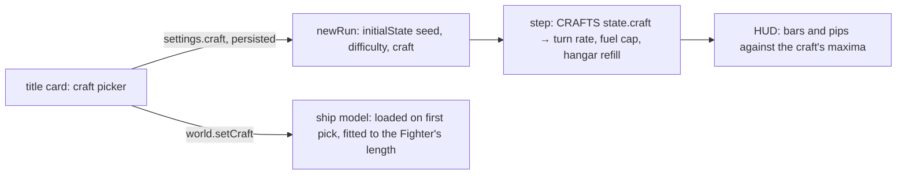

# Craft select (P17)

SPEC.md §3 holds the stats. This file adds the structure and the invariants the tests pin.

## Invariants (EARS)

- **INV-1**: The Fighter shall have exactly the §3 numbers.
- **INV-2**: A craft shall start, and refill at the hangar, to its own fuel, hull and rocket maxima.
- **INV-3**: One full-axis tick shall turn a craft by exactly its turn rate.
- **INV-4**: The same seed, difficulty, craft and inputs shall replay to a deep-equal state.
