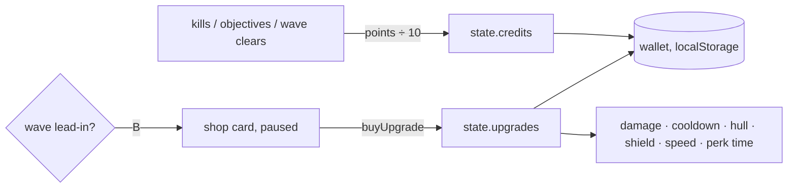
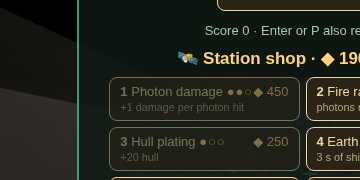

# Credits and station shop

SPEC.md §6 holds the rules. This file adds the structure and the invariants the tests pin.

## Invariants (EARS)

- **INV-1**: WHEN a tick's events include kills, met objectives or wave clears THE sim SHALL add floor(points ÷ 10) credits, unless the run doesn't earn credits.
- **INV-2**: THE shop SHALL sell only while the wave is in its lead-in and the run is live.
- **INV-3**: WHEN buyUpgrade is called for an upgrade below level 3 with enough credits THE sim SHALL deduct the price (100, 250, 450) and raise the level by 1; otherwise it SHALL return the state unchanged.
- **INV-4**: THE upgrades SHALL apply deterministically: photon damage 1 + level, photon cooldown max(2, 5 − level), hull +20 per level, an Earth shield of 3 s × level at each wave start, forward speed +10 % per level and timed perks +20 % per level.
- **INV-5**: THE web SHALL save credits globally and upgrades per ship in localStorage and SHALL start each normal run from them.
- **INV-6**: WHEN a run doesn't earn credits (the daily challenge) THE web SHALL leave the wallet unchanged.

