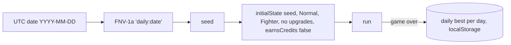
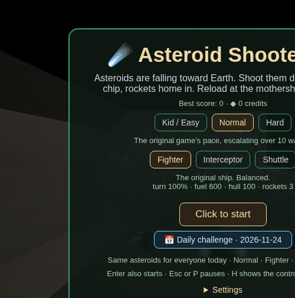

# Daily challenge

SPEC.md §6 holds the rules. This file adds the structure and the invariants the tests pin.

## Invariants (EARS)

- **INV-1**: THE daily seed SHALL be FNV-1a of 'daily:' + the UTC date, so everyone gets the same run that UTC day.
- **INV-2**: THE daily run SHALL use Normal difficulty, the Fighter, no upgrades and no credits, and SHALL NOT earn credits or open the shop.
- **INV-3**: WHEN a daily run ends THE web SHALL store the score as today's best if it beats it; a stored best from another day SHALL read as 0.
- **INV-4**: THE daily run SHALL NOT change the all-time best or the top 10.
- **INV-5**: THE title card SHALL offer a Daily challenge button showing the UTC date and today's best.

