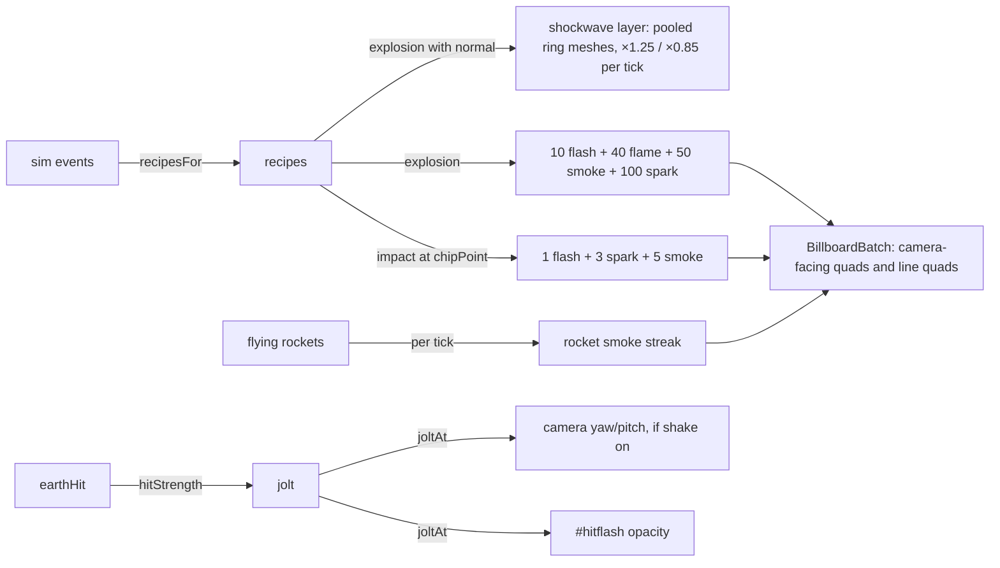

# Explosions: shockwave, sparks, smoke and Earth-hit feedback (P12)

SPEC.md §12 holds the rules. This file adds the structure and the invariants the tests pin.

## Invariants (EARS)

- **INV-1**: Every explosion particle and shockwave shall die within 200 FX ticks.
- **INV-2**: Before flattening, a line sprite's width shall be ⊥ the line and ⊥ the eye ray to its middle, and
  `ratio × length` across.
- **INV-3**: The camera shake shall never exceed `SHAKE_MAX_RAD` per axis, and the flash shall stay within
  `[0, FLASH_MAX]`.
- **INV-4**: The engine shall never hold more than `MAX_SHOCKWAVES` shockwaves, and shall drop the oldest first.
- **INV-5**: When shake is off, an Earth hit shall leave the camera still, and the flash shall still show.
