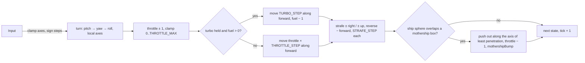

# Flight (P03)

The sim skeleton and the ship flight model: SPEC.md §2–§3 and §7, step 1, plus the mothership push-out from step 2.
SPEC.md stays the source of every rule and value; this file adds the structure and the invariants the tests pin.

## Invariants (EARS)

- **INV-1**: The sim shall keep the ship's orientation a unit quaternion (|q| = 1 ± 1e-9) after any input sequence.
- **INV-2**: The sim shall keep the throttle an integer in 0..`THROTTLE_MAX`.
- **INV-3**: The sim shall keep fuel an integer in 0..`FUEL_MAX`, never increasing it during flight.
- **INV-4**: While turbo is held and fuel > 0, the sim shall move the ship exactly `TURBO_STEP` along forward plus
  any strafe, and spend 1 fuel.
- **INV-5**: The sim shall move the ship at most `TURBO_STEP + 3 × STRAFE_STEP` per tick before the push-out.
- **INV-6**: When a tick ends, the ship's sphere shall not overlap any mothership box it was pushed out of.
- **INV-7**: The same seed and input log shall give a deep-equal state (replay).
- **INV-8**: If an input axis is non-finite or out of [−1, 1], the sim shall treat it as 0 or clamp it, so state stays finite.
- **INV-9**: `step` shall advance `tick` by exactly 1, and never mutate its input state.
