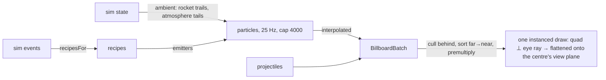

# Effects: BillboardBatch, ported particles and the FX bus (P11)

SPEC.md §12 holds the rules. This file adds the structure and the invariants the tests pin.

## Invariants (EARS)

- **INV-1**: Flattening shall leave every sprite corner on its own eye ray (the screen image is unchanged) at its
  centre's view depth.
- **INV-2**: Before flattening, each quad shall be perpendicular to the eye ray, with corners `size·√2` from its centre.
- **INV-3**: The batch shall draw sprites farthest first, with equal depths in a stable order.
- **INV-4**: Additive sprites shall write α = 0; every sprite shares the blend `ONE, ONE_MINUS_SRC_ALPHA`.
- **INV-5**: Every particle shall die in bounded time (flash ≤ 60 ticks, flame ≤ 30, flare ≤ 100, glint ≤ 400).
- **INV-6**: The engine shall never hold more than `MAX_PARTICLES`, and shall drop the oldest first.
- **INV-7**: FX shall never change the sim state.
