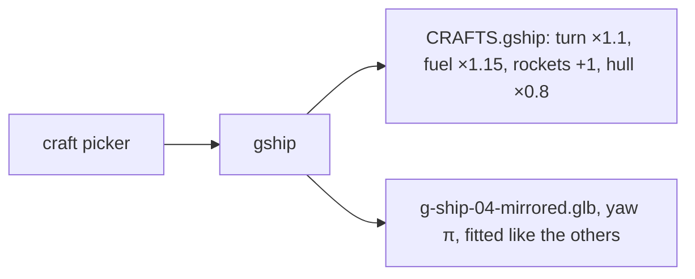

# G-Ship craft

SPEC.md §3 holds the rules. This file adds the structure and the invariants the tests pin.

## Invariants (EARS)

- **INV-1**: THE craft list SHALL be fighter, interceptor, shuttle, gship, and the default SHALL stay the Fighter.
- **INV-2**: THE G-Ship SHALL turn at 1.1×, carry 1.15× fuel and one extra rocket, with 0.8× hull, relative to the Fighter.
- **INV-3**: THE G-Ship SHALL use the full mirrored g-ship model turned π about Y so its nose faces forward, fitted to the shared ship length.

