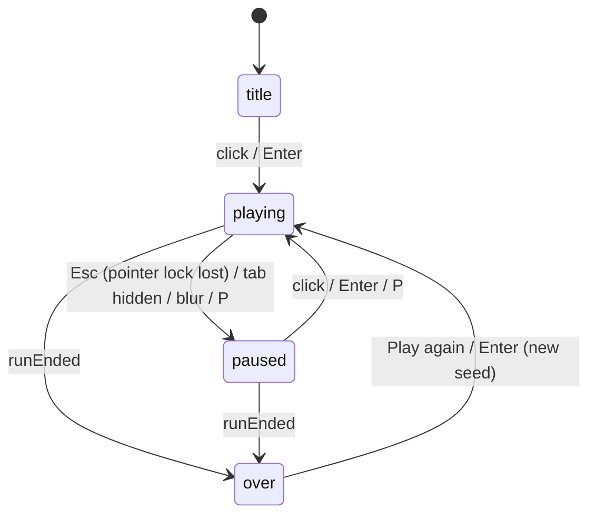

# Game loop, HUD v0 and audio (P07)

SPEC.md §6 (best score) and §9 hold the rules. This file adds the structure and the invariants the web tests pin.

Each tick's events go to `addStats` (game-over stats), `cuesFor` (WebAudio), `burstsFor` (placeholder FX), and on
`runEnded` to `updateBest`, which writes `localStorage`.

## Invariants (EARS)

- **INV-1**: `nextPhase` shall follow the diagram and leave the phase unchanged for actions that don't apply.
- **INV-2**: The sim shall not tick unless the phase is `playing`.
- **INV-3**: The best score shall only change when a run ends with a strictly higher score, and stored garbage shall read as 0.
- **INV-4**: Each tick shall play at most `MAX_CUES_PER_TICK` sounds, and nothing while muted or before the first input.
- **INV-5**: The HUD bars shall show fractions in [0, 1]. The speed gauge shall be full exactly while the turbo moves the ship.
- **INV-6**: Run stats shall count every kill, photon fired and hit, rocket fired and Earth hit in the run's events.
