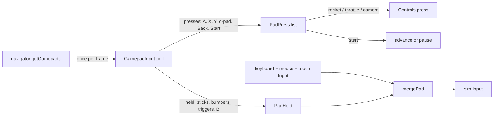

# Gamepad (P19)

SPEC.md §8 holds the rules. This file adds the structure and the invariants the tests pin.

## Invariants (EARS)

- **INV-1**: A button held across many polls shall yield exactly one press.
- **INV-2**: Stick output shall be 0 inside the dead zone and stay within the unit disc.
- **INV-3**: The merged pitch, yaw, roll and strafe shall stay within [−1, 1].
- **INV-4**: With no pad connected, the merged input shall equal the keyboard/mouse/touch input.
- **INV-5**: When the pad disconnects, every held control shall release.
- **INV-6** (P22): While a pad is connected, every card button Start triggers shall name Start; after a disconnect the prompts shall revert to Tap / Click.
