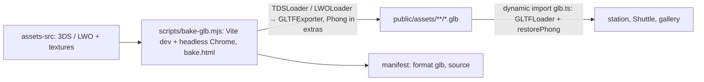

# GLB models (P25)

SPEC.md §14 holds the rules. This file adds the structure and the invariants the tests pin.

## Invariants (EARS)

- **INV-1**: The manifest shall list no 3DS or LWO model; every GLB shall name its source, which shall exist in `assets-src/`.
- **INV-2**: The deployed build shall contain no TDSLoader or LWOLoader, and no `.3ds` / `.lwo` file.
- **INV-3**: A baked model shall keep its triangle count, size and node transforms, so the game's fitting is unchanged.
- **INV-4**: Phong materials recorded at bake time shall be rebuilt as Phong on load.
