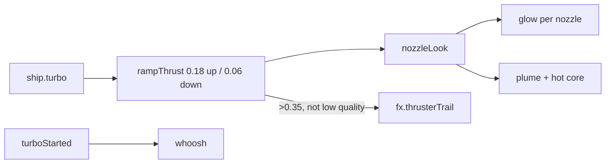
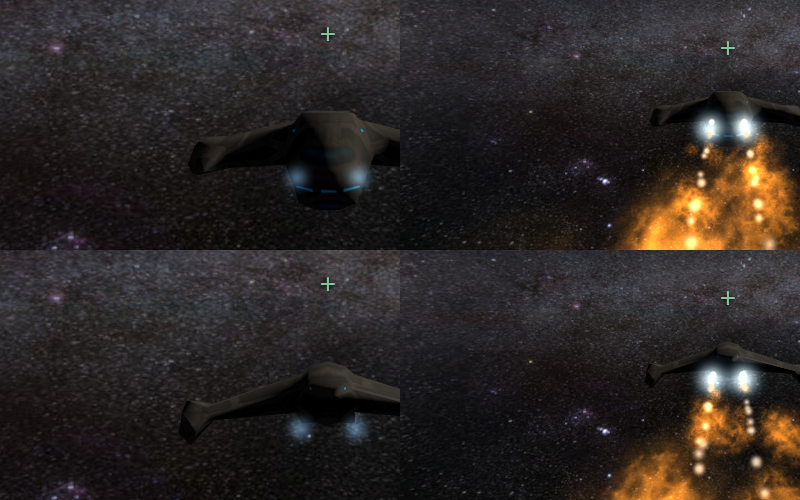

# Hyperdrive thrusters

SPEC.md §8 holds the rules. This file adds the structure and the invariants the tests pin.

## Invariants (EARS)

- **INV-1**: WHEN the ship is visible in the chase camera THE renderer SHALL draw a glow at each nozzle of the craft, scaled by throttle.
- **INV-2**: WHILE hyperdrive (Shift) is on THE burn level SHALL rise by 0.18 per tick to 1 and SHALL fall by 0.06 per tick to 0 after release.
- **INV-3**: WHILE the burn level is above 0 THE renderer SHALL draw a hot plume streaming backward from each nozzle.
- **INV-4**: WHILE the burn level is above 0.35 and graphics quality is not low THE fx engine SHALL emit trail particles, within the particle cap.
- **INV-5**: WHEN turboStarted is emitted THE audio SHALL play a whoosh.
- **INV-6**: THE thrusters SHALL be render-only and SHALL NOT change sim state.

