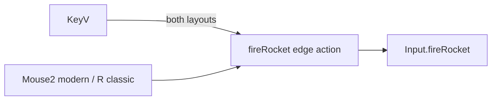

# Keyboard rockets (P27)

SPEC.md §8 holds the rules. This file adds the structure and the invariants the tests pin.

## Invariants (EARS)

- **INV-1**: Every flight action shall have a keyboard binding in both layouts.
- **INV-2**: V shall fire a rocket in both layouts and clash with no other binding.
