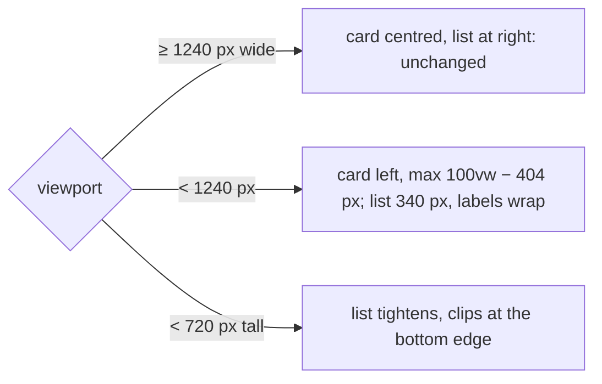

# Overlay layout on narrow screens (P21)

SPEC.md §8 holds the rule. CSS media queries in `index.html`; checked in headless Chrome at six viewports.

## Invariants (EARS)

- **INV-1**: While the title or pause card shows, the controls list shall not intersect the card at any viewport ≥ 740×360.
- **INV-2**: At ≥ 1240 px wide the layout shall be unchanged.
