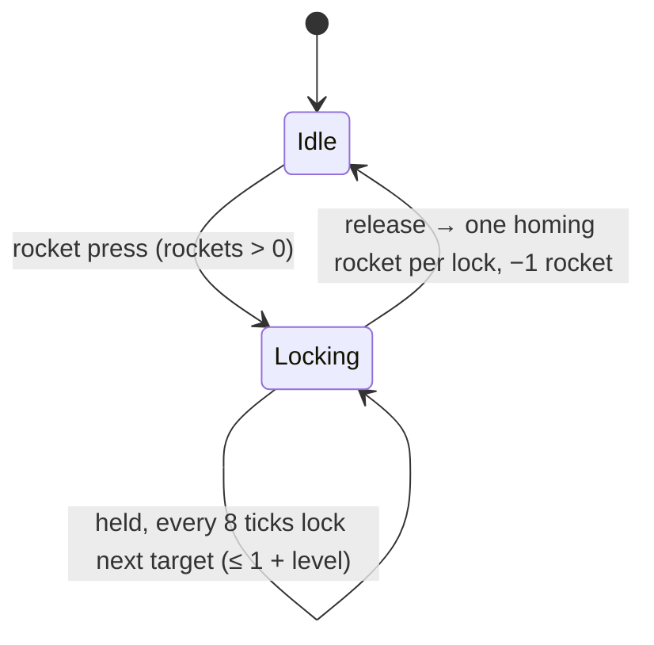
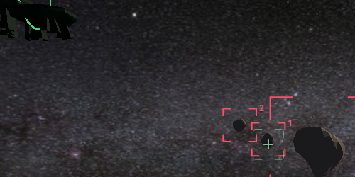

# Lock-on missiles

SPEC.md §5 holds the rules. This file adds the structure and the invariants the tests pin.

## Invariants (EARS)

- **INV-1**: WHILE missiles level is 0 THE rocket button SHALL fire one rocket per press, as before.
- **INV-2**: WHEN missiles level L ≥ 1 and the rocket button is pressed with rockets left THE sim SHALL start locking and lock the crosshair target at once.
- **INV-3**: WHILE the rocket button is held THE sim SHALL lock the next-best target in the lock cone every 8 ticks, up to 1 + L locks, and emit missileLocked.
- **INV-4**: WHEN the rocket button is released THE sim SHALL fire one homing rocket per lock (one unlocked rocket if none) for one rocket of ammo and clear the locks.
- **INV-5**: WHEN a locked asteroid is destroyed THE sim SHALL drop its lock.
- **INV-6**: THE HUD SHALL show the volley size, the lock count while locking, and numbered red brackets on locked asteroids.
- **INV-7**: Missiles SHALL be sold in the station shop at 200 / 350 / 550 credits.

