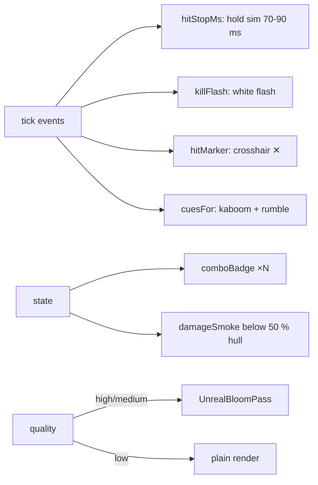
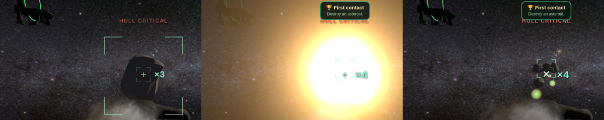

# Look and feel

SPEC.md §12 holds the rules. This file adds the structure and the invariants the tests pin.

## Invariants (EARS)

- **INV-1**: WHILE graphics quality is high or medium THE renderer SHALL apply bloom; WHILE it is low THE renderer SHALL render without post-processing.
- **INV-2**: THE sky SHALL show a seeded procedural nebula just inside the star sphere, following the camera.
- **INV-3**: WHEN a big asteroid is destroyed by a photon or rocket THE web SHALL hold the sim for 70 ms and flash white; WHEN a smart bomb fires it SHALL hold 90 ms.
- **INV-4**: WHILE the ship's hull is below half its maximum THE fx SHALL emit smoke from the ship's tail, more as hull falls.
- **INV-5**: WHEN a photon or rocket hits or kills an asteroid THE HUD SHALL flash a hit marker on the crosshair (bigger and orange for a kill).
- **INV-6**: WHILE a combo's multiplier is ×2 or more THE HUD SHALL show it beside the crosshair, growing with the multiplier.
- **INV-7**: WHEN a big asteroid is destroyed, a smart bomb fires or the run ends THE audio SHALL layer a synthesised rumble under the bang.
- **INV-8**: WHEN screen shake is off THE white kill flash SHALL NOT show.

