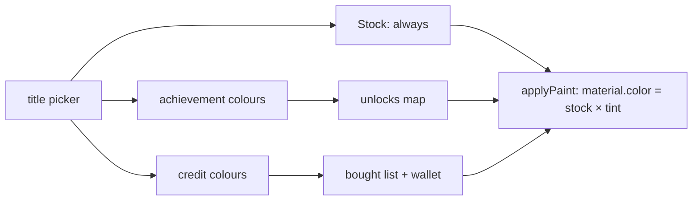

# Paint colours (P39)

SPEC.md §3 holds the rules. This file adds the structure and the invariants the tests pin.

Unlockable tints for each craft. They are render-only: the sim never sees them. Stock is always free. Four colours come with achievements, and three can be bought with credits. The chosen colour is saved per ship.

## Invariants (EARS)

- **INV-1**: THE sim SHALL be unchanged by a paint: it is render-only and never written into run state.
- **INV-2**: Stock SHALL always be unlocked. An achievement colour SHALL unlock iff that achievement is unlocked. A credit colour SHALL unlock iff it has been bought.
- **INV-3**: THE chosen colour SHALL be saved per ship. A missing or unknown value SHALL fall back to Stock.
- **INV-4**: Buying a colour SHALL deduct its price once, and only when the wallet can afford it and it is not already bought.
