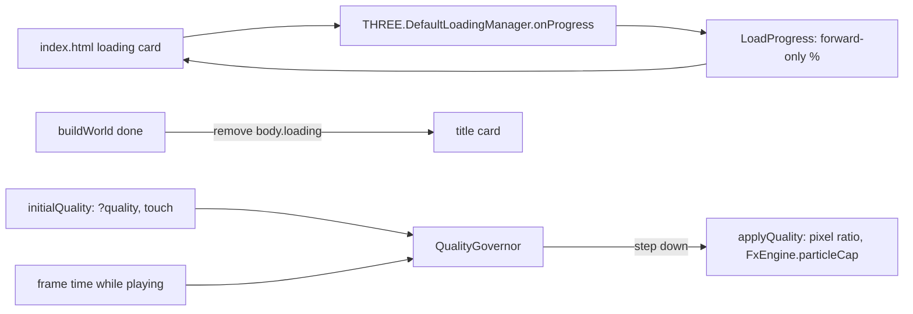

# Performance and loading (P20)

SPEC.md §14 holds the rules. This file adds the structure and the invariants the tests pin.

## Invariants (EARS)

- **INV-1**: The loading percentage shall never decrease, and shall read 100 only when loaded equals total.
- **INV-2**: Quality shall only step down, one level per slow window, never below low.
- **INV-3**: A pinned quality (`?quality=`) shall never change.
- **INV-4**: Frames longer than STALL_MS and the warm-up shall never cause a step.
- **INV-5**: The FX engine shall keep at most min(particleCap, MAX_PARTICLES) particles.
- **INV-6**: Quality shall never change the sim's state or its replays.
