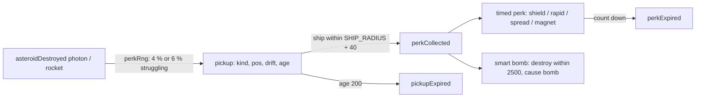

# Perks (P26)

SPEC.md §15 holds the rules. This file adds the structure and the invariants the tests pin.

## Invariants (EARS)

- **INV-1**: Rolling drops shall never change the main `rng`.
- **INV-2**: Pickups shall stay sorted by unique id and younger than PICKUP_LIFE.
- **INV-3**: A timed perk's ticks left shall stay within [0, its duration]; a repeat pickup shall refresh, never stack.
- **INV-4**: Smart-bomb kills shall never drop pickups and shall never split.
- **INV-5**: While the shield is up, Earth health shall not fall from impacts.
- **INV-6**: The same seed and inputs shall give the same drops, pickups and perks.
