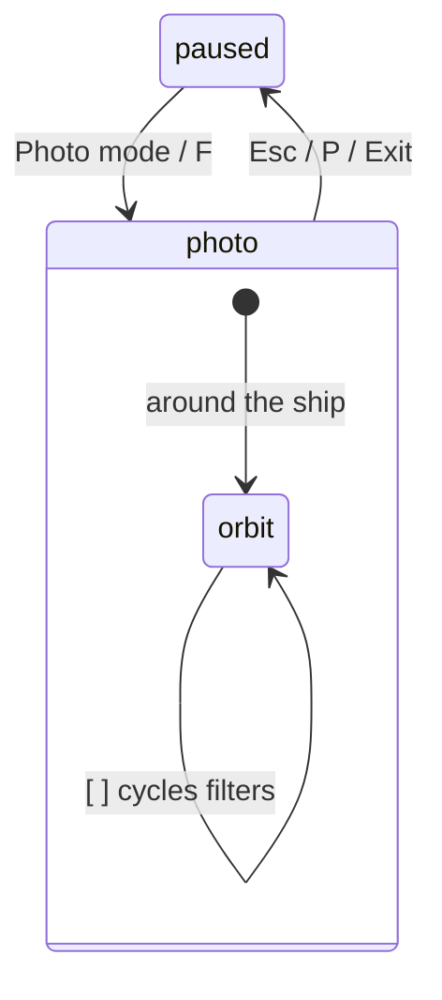

# Photo mode (P38)

SPEC.md §8 holds the rules. This file adds the structure and the invariants the tests pin.

Pause opens a free camera for screenshots. The sim stays paused. The HUD, help, radar and pause card hide. A slim bar keeps Save, Exit, the filter and the focus. Exit returns to the pause card.

## Invariants (EARS)

- **INV-1**: WHILE photo mode is open, THE sim SHALL not tick and THE phase SHALL stay paused.
- **INV-2**: WHEN the player exits photo mode, THE pause card SHALL return with the run still paused at the same tick.
- **INV-3**: THE camera SHALL stay a legal orbit: pitch in (−1.45, 1.45) rad and distance in [20, 8000].
- **INV-4**: A saved file SHALL be named `asteroid-shooter-3d-YYYY-MM-DD-HHMMSS.png`, with no player name or logo.
