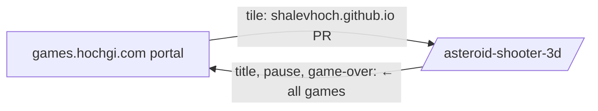

# Portal look and portal entry (P14)

SPEC.md §9 holds the rules.

## Invariants (EARS)

- **INV-1**: The game page shall use only the portal palette for its chrome (gold, sage and green on dark cards).
- **INV-2**: The title, pause and game-over cards shall each link back to `/`.
- **INV-3**: The favicon shall resolve under the Pages base path.
