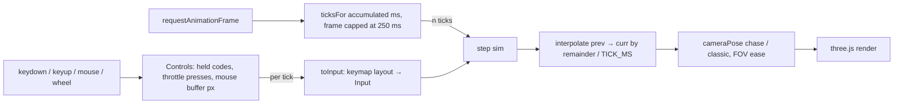

# Renderer loop and input (P04)

SPEC.md §8 holds the rules. This file adds the structure and the invariants the web tests pin.

## Invariants (EARS)

- **INV-1**: Each layout shall bind every flight action, a layout toggle and help.
- **INV-2**: The keymap shall ignore codes it doesn't bind, including inherited object keys.
- **INV-3**: `toInput` shall cancel opposing held actions and clamp key + mouse axes to [−1, 1].
- **INV-4**: `toInput` shall apply at most one throttle level per tick, in the pressed direction.
- **INV-5**: `consumeMouse` shall return an axis in [−1, 1], keep at most `MOUSE_BUFFER_TICKS` ticks of turn buffered,
  and treat non-finite input as none.
- **INV-6**: `interpolate` shall return the endpoints at α = 0 and 1, clamp α, and take the shortest rotation arc.
- **INV-7**: The FOV shall ease toward its target without overshooting.
- **INV-8**: Corrupt or unknown stored settings shall fall back to the defaults field by field.
