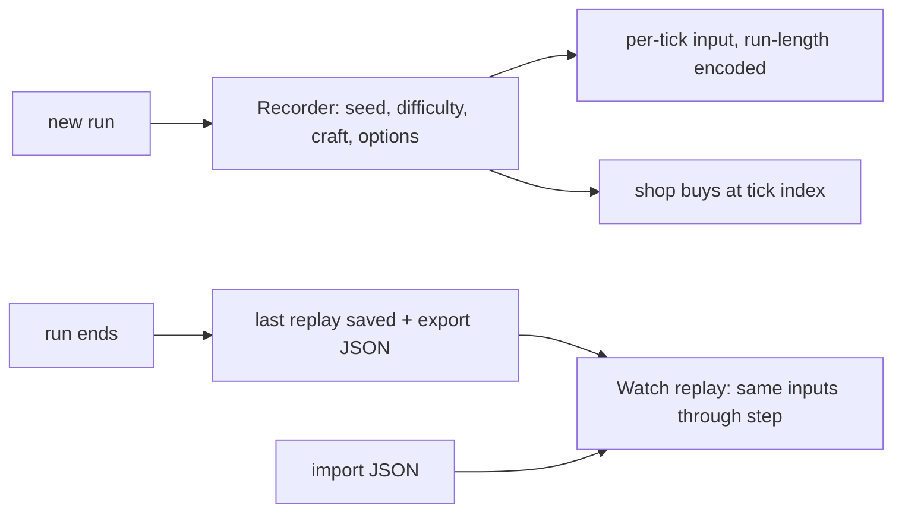

# Replays

SPEC.md §3 holds the rules. This file adds the structure and the invariants the tests pin.

## Invariants (EARS)

- **INV-1**: THE game SHALL record every run as its seed, difficulty, craft, start options, per-tick inputs and shop buys.
- **INV-2**: WHEN a replay is played through the sim, THE final state SHALL equal the recorded run's final state.
- **INV-3**: WHILE a replay is watched, THE game SHALL not change the best score, top 10, daily best, wallet, achievements or tutorial, and SHALL ignore the player's flight input and shop buys.
- **INV-4**: WHEN an imported file is not a valid replay, THE game SHALL reject it with a message and keep the current one.
