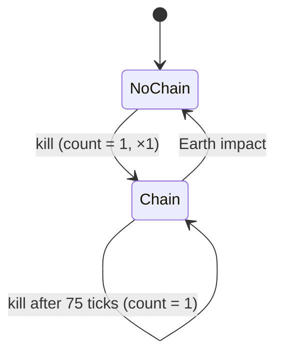
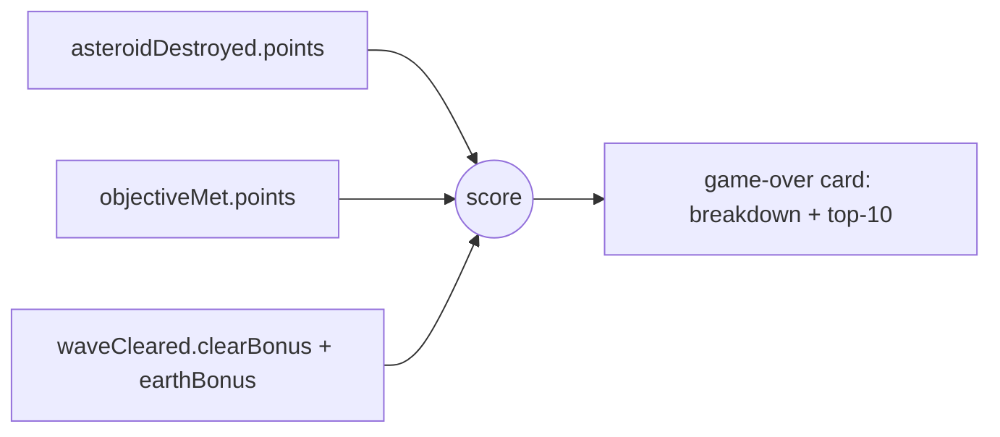

# Scoring v2, run summary and top-10 (P10)

SPEC.md §6 holds the rules. This file adds the structure and the invariants the tests pin.

## Invariants (EARS)

- **INV-1**: The score shall always equal the sum of the scored events' points (`pointsIn`).
- **INV-2**: Each kill shall pay `base × multiplier`, with `multiplier = comboMultiplier(combo)`.
- **INV-3**: The multiplier shall never exceed `COMBO_MAX_MULTIPLIER` (4).
- **INV-4**: The score shall never decrease.
- **INV-5**: The run summary's breakdown shall add up to the score.
- **INV-6**: The top-10 shall hold at most 10 runs, best first, and never a 0-point run.
- **INV-7**: The same seed, difficulty and inputs shall replay to the same score, combo and events.
