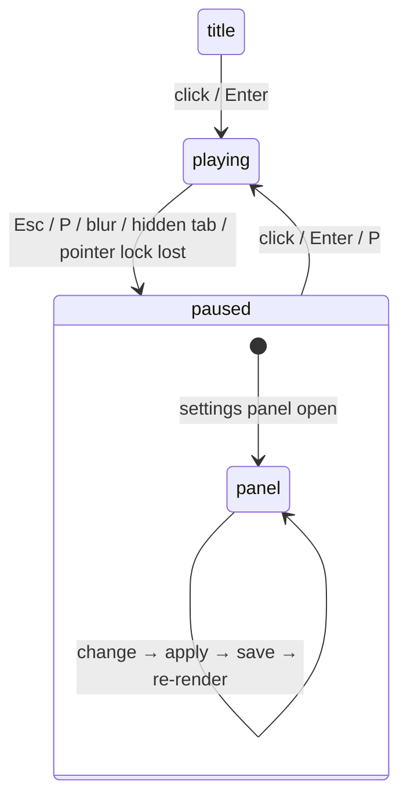

# Pause, help and settings overlay (P13)

SPEC.md §8 holds the rules. This file adds the structure and the invariants the tests pin.

Settings flow: `parseSettings(localStorage)` → live `settings` object (read by Controls each tick, AudioBank on each
play) → `changeSetting` → `saveSettings` → `renderOverlay` + `renderHelp`.

## Invariants (EARS)

- **INV-1**: While paused, the sim shall not tick.
- **INV-2**: `parseSettings(JSON.stringify(s))` shall equal `s` for any settings `s` the panel can produce.
- **INV-3**: Sensitivity shall stay within [0.25, 3] and volume within [0, 1], on the step grid, whatever is stored.
- **INV-4**: The help list shall show the bindings of the active layout.
- **INV-5**: A difficulty change mid-run shall not change the running sim; it shall apply to the next run.
