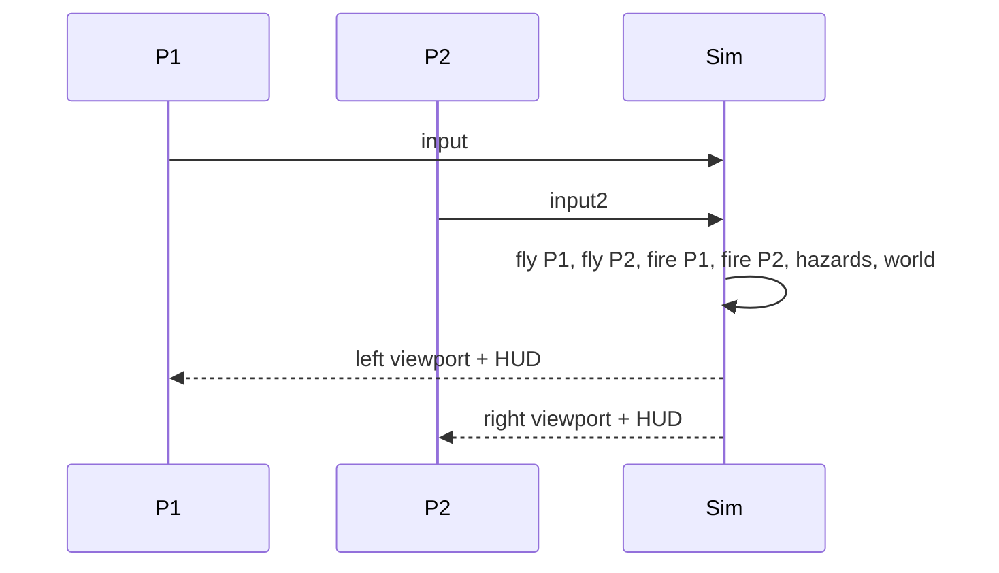

# Two-player split screen (P40)

SPEC.md §8 holds the rules. This file adds the structure and the invariants the tests pin.

Local co-op with two gamepads. P1 is the left view and the first pad (the keyboard still steers P1). P2 is the right view and the second pad. Earth, waves, score, credits and perks are shared. Single-player runs are unchanged.

## Invariants (EARS)

- **INV-1**: WHEN only one pad (or none) is connected, or the regular start button is used, THE run SHALL be a single-player run whose state has no `ship2`.
- **INV-2**: THE sim SHALL apply P1's input first, then P2's, so the same two input logs replay to the same state.
- **INV-3**: THE run SHALL end when Earth is destroyed, or when both ships have no hull left. One living ship SHALL keep the run going.
- **INV-4**: A 1P `step(state, input)` SHALL equal `step(state, input, NO_INPUT)` and SHALL not invent a second ship.
