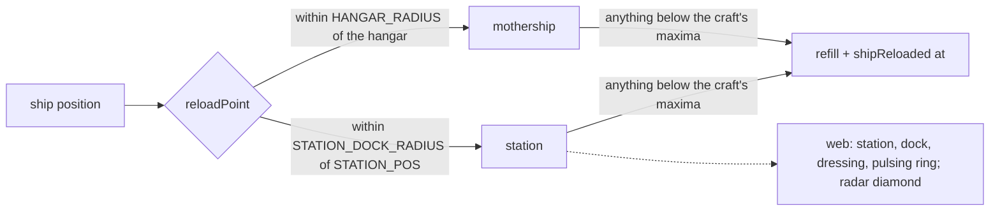

# Space station landmark and second reload point (P18)

SPEC.md §3 holds the rules.

## Invariants (EARS)

- **INV-1**: Inside the dock radius, a ship below its maxima shall refill to its craft's maxima, and `shipReloaded`
  shall say `station`.
- **INV-2**: Outside both reload points, nothing shall refill.
- **INV-3**: The station shall sit clear of the atmosphere and above the asteroid spawn spread.
