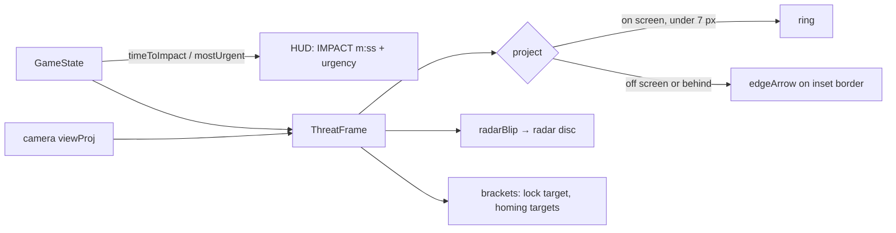

# Threat awareness (P09)

SPEC.md §11 holds the rules. This file adds the structure and the invariants the tests pin.

## Invariants (EARS)

- **INV-1**: Every asteroid shall be either on screen or marked by an arrow on the inset screen border.
- **INV-2**: For a point behind the camera, the arrow shall point the way to turn (mirrored), never nowhere.
- **INV-3**: The predicted time to impact shall equal the tick on which the impact happens (⌈TTI⌉).
- **INV-4**: The most urgent asteroid shall be the smallest TTI, ties broken by the lowest id.
- **INV-5**: Radar blips beyond the range shall sit on the rim; forward shall map to up.
- **INV-6**: The overlay shall not read or change the sim state beyond pure queries.
