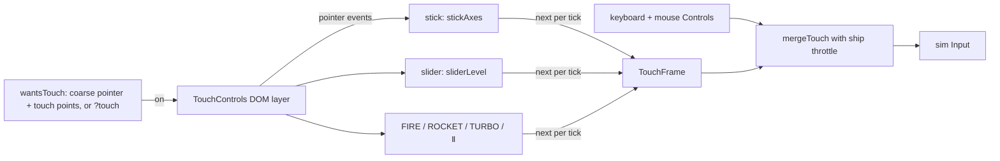

# Touch controls (P15)

SPEC.md §8 holds the rules. This file adds the structure and the invariants the tests pin.

## Invariants (EARS)

- **INV-1**: Stick axes shall stay within the unit disc, be 0 inside the dead zone, and keep the finger's direction.
- **INV-2**: The merged pitch and yaw shall stay within [−1, 1].
- **INV-3**: The slider shall change the throttle by at most one level per tick, and never past its target.
- **INV-4**: With nothing touched, the merged input shall equal the keyboard/mouse input.
- **INV-5**: Touch controls shall show only while playing.
