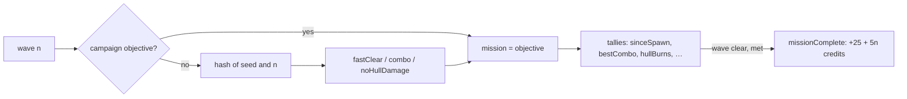
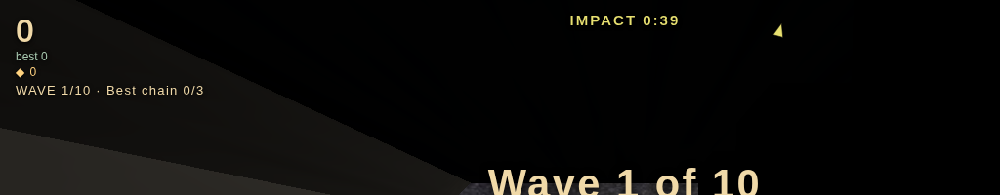

# Wave missions

SPEC.md §10 holds the rules. This file adds the structure and the invariants the tests pin.

## Invariants (EARS)

- **INV-1**: THE sim SHALL give every wave exactly one mission: its campaign objective where one exists, else one drawn from fastClear, combo and noHullDamage by a hash of the run's seed and the wave number.
- **INV-2**: THE seeded draw SHALL NOT consume the game or perk RNG streams.
- **INV-3**: WHEN a wave starts THE waveStarted event SHALL carry the wave's mission, and the banner SHALL name it.
- **INV-4**: WHEN a wave clears with its mission met THE sim SHALL emit missionComplete with 25 + 5 × wave bonus credits, and the run SHALL bank them.
- **INV-5**: WHEN a seeded mission is met THE sim SHALL NOT add points or repair; campaign objectives keep their points and repair.
- **INV-6**: THE HUD SHALL show the mission's live progress while the wave is active.

