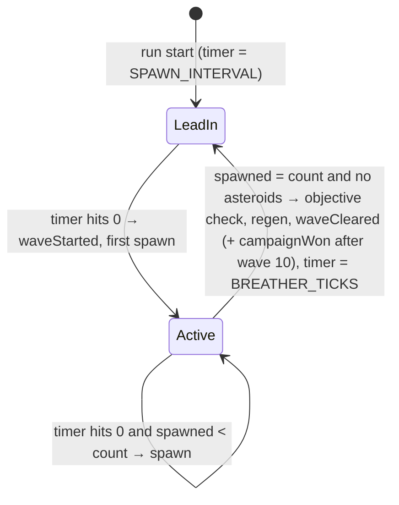

# Waves, objectives and difficulty (P08)

SPEC.md §10 holds the rules. This file adds the structure and the invariants the tests pin.

## Invariants (EARS)

- **INV-1**: The sim shall spawn exactly `waveDef(n).count` asteroids in wave *n* (split pieces don't count).
- **INV-2**: Waves shall escalate strictly through the campaign: count, speed, density and big chance all increase.
- **INV-3**: On Normal, wave 1 shall match the original's schedule (spawns at ticks 200, 400, …, 1000 at speed 3).
- **INV-4**: Earth health shall never exceed `EARTH_MAX_HEALTH` after a repair or regen.
- **INV-5**: An objective's points shall enter the score exactly once, with an `objectiveMet` event.
- **INV-6**: `campaignWon` shall fire exactly once, at wave 10's clear, and the run shall continue afterwards.
- **INV-7**: The same seed, difficulty and input log shall replay to a deep-equal state.
