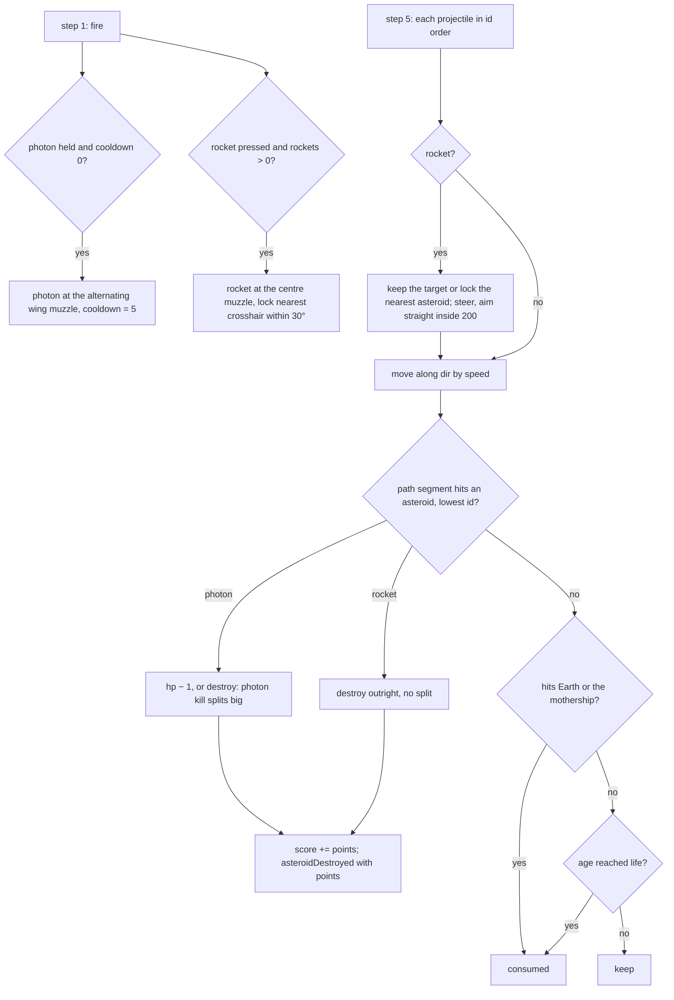

# Weapons and base scoring (P06)

SPEC.md §5 and §6 hold the rules. This file adds the structure and the invariants the tests pin.

## Invariants (EARS)

- **INV-1**: A rocket locked on an asteroid that nothing else destroys, with nothing in the way, shall hit it within
  `ROCKET_LIFE` ticks (1000 randomised trials: any direction, 150–2000 units away, a moving big or small target).
- **INV-2**: The score shall always equal the sum of the `points` in every `asteroidDestroyed` event so far.
- **INV-3**: Projectiles shall stay sorted by id, with age below their life.
- **INV-4**: Rockets carried shall stay in 0..`ROCKET_MAX`.
- **INV-5**: Photons shall fire at most once per `PHOTON_COOLDOWN` ticks, alternating wings.
- **INV-6**: A projectile shall not pass through an asteroid between ticks (swept test), and an asteroid destroyed
  earlier in a tick shall not be hit again.
